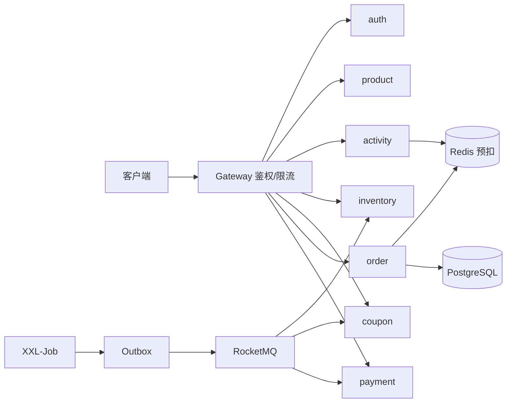

# FlashSale 秒杀系统

基于 Java 21 + Spring Boot 3 + Spring Cloud 的微服务秒杀实践项目。围绕"高并发下的库存安全、幂等和最终一致性"搭建了完整链路，并在本地 Docker 环境中完成压测与对账验收。

核心目标：**库存不超卖、重复请求不重复扣减、异步链路最终一致、活动状态可安全暂停与恢复**。

## 技术栈

| 层次 | 选型 |
|---|---|
| 语言 / 框架 | Java 21、Spring Boot 3、Spring Cloud Gateway |
| 注册与配置 | Nacos 2.4 |
| 存储 | PostgreSQL 16（最终账本）、Redis 7（原子预扣与限购） |
| 消息 | RocketMQ 5.3（Outbox 异步事件） |
| 调度 | XXL-Job 2.4（Outbox 投递、预热、恢复、对账） |
| 可观测性 | Prometheus、Grafana、Loki、Alertmanager、SkyWalking 10 |
| 部署 / 压测 | Docker Compose、k6 |

## 系统架构



一次秒杀下单的主链路：

```text
请求 → Gateway 鉴权/限流 → Redis Lua 原子预扣（库存 + 限购）
     → PostgreSQL 本地事务写订单、库存记录和 Outbox
     → XXL-Job 投递 Outbox → RocketMQ
     → 消费端幂等处理 → PostgreSQL 投影追平 → 对账与补偿
```

## 目录结构

| 目录 | 说明 |
|---|---|
| `flashsale-gateway` | 统一入口、鉴权、角色校验、限流 |
| `flashsale-auth` | 注册、登录、JWT、账户状态 |
| `flashsale-product` | 商品管理、上下架、查询缓存 |
| `flashsale-activity` | 活动、预热、库存门闸、暂停/恢复屏障 |
| `flashsale-inventory` | 库存预占、确认、释放 |
| `flashsale-coupon` | 优惠券模板、领券、限领、核销 |
| `flashsale-order` | 下单、幂等、取消、超时处理 |
| `flashsale-payment` | 支付、回调、支付幂等、履约 |
| `flashsale-job` | XXL-Job 对账、补偿、恢复任务 |
| `flashsale-common` | 认证、Trace、Outbox、消息等基础设施 |
| `flashsale-migration` | Flyway 数据库迁移 |
| `db` / `config` | 初始化脚本与 Nacos/Prometheus/Loki/Grafana 配置 |
| `load` | H03 k6 压测脚本、数据准备、对账 SQL |
| `docs` | 需求、设计、验收记录与测试证据 |

## 核心设计

### 1. Redis Lua 原子预扣

库存校验、限购校验和预扣在**同一段 Lua 脚本**内完成，避免"先查后扣"的竞态；数据库库存和库存流水作为最终账本，Redis 只承担高并发入口。

### 2. Outbox + RocketMQ 最终一致性

业务记录与 Outbox 在同一个 PostgreSQL 本地事务中提交。XXL-Job 每秒触发 `outboxDispatch` 投递到 RocketMQ，消费端用独立幂等表去重，失败消息可重试，积压可由对账任务发现。

### 3. 三层幂等防护

业务幂等键（`user_id + idempotency_key`）+ 数据库唯一约束 + 状态 CAS。相同键重放返回首次结果；相同键不同请求体返回 `IDEMPOTENCY_CONFLICT`。

### 4. 活动状态机与暂停/恢复屏障

`NOT_STARTED → 预热 → ACTIVE → PAUSED → 恢复 → ACTIVE`。暂停时先关闭 Redis 新预扣门闸，再截取事件屏障；恢复前校验 Outbox、事件序号、库存 checkpoint、库存流水和 Redis 状态，全部追平后才 CAS 回 `ACTIVE` 并重开门闸。

### 5. 可观测性

请求与异步事件统一透传 Trace ID；结构化日志包含用户、订单、事件、幂等和 Outbox 字段；Prometheus + Grafana + Loki + SkyWalking + Alertmanager 组成监控与追踪体系。

## 实测结果

以下数据来自本机 Docker 环境（16 GB 内存，25 个容器），原始输出与对账记录见 [H03 验收记录](docs/h03-acceptance/README.md)。

| 场景 | 结果 |
|---|---|
| 500 QPS × 20 秒抢购（库存 300） | 10,001 次请求，dropped 0，P50 4.0 ms，P95 81 ms；成交恰好 300 单 |
| 幂等重放（100 VU × 30 秒，同一幂等键） | 82,453 次重复提交仅产生 100 笔订单，重复有效订单 0 |
| 活动暂停 / 恢复 | 暂停期新预扣全部拒绝，恢复后继续成交；12 笔订单下 Redis 288 = PostgreSQL 288，事件序号 1–12 连续无空洞 |
| 七项 SQL 对账 | 负库存、重复有效订单、事件断号、Outbox 积压、消费幂等未完成、无订单的预留，全部 0 违规 |

对账脚本本身在 [`load/h03/verify.sql`](load/h03/verify.sql)，压测场景在 [`load/k6/h03.js`](load/k6/h03.js)。

## 快速开始

### 环境要求

- Docker Engine + Docker Compose v2
- 本地 Maven 开发需要 Java 21、Maven 3.9+
- H03 数据准备脚本需要 `curl`、`jq`

### 启动基础环境与业务服务

```bash
cp .env.example .env        # 按需修改密码与端口
docker compose --profile r21 up -d \
  postgres redis nacos migration xxl-mysql xxl-job-admin \
  rocketmq-namesrv rocketmq-broker rocketmq-init \
  auth gateway product activity inventory coupon order payment job
```

Gateway 默认地址 `http://127.0.0.1:8080`。管理员账号由 `.env` 的 `ADMIN_USERNAME` / `ADMIN_PASSWORD` 控制。

> 基础 Compose 默认关闭 Outbox 投递与消费者；需要完整异步链路时使用 H03 独立环境。

### 角色与权限

| 角色 | 职责 |
|---|---|
| `CUSTOMER` | 下单、领券、支付等前台操作 |
| `OPERATOR` | 商品、活动、优惠券等业务管理 |
| `ADMIN` | 只管理账户，不能操作业务数据 |

`OPERATOR` 账号由 `ADMIN` 通过 `POST /api/v1/admin/users` 创建，不存在默认运营账号。网关会按路径校验角色，越权访问返回 `403 FORBIDDEN`。

### H03 独立验收环境

H03 使用独立 Compose project 和临时卷，不影响日常环境：

```bash
H03_SCENARIO=activity_burst load/h03/run.sh up
ADMIN_PASSWORD=change-me-admin-password H03_SCENARIO=activity_burst load/h03/run.sh prepare
H03_USER_COUNT=2000 LOAD_TOKENS_FILE=load/h03/tokens.txt load/h03/prepare-users.sh
H03_SCENARIO=activity_burst LOAD_TOKENS_FILE=load/h03/tokens.txt load/h03/run.sh run
load/h03/run.sh verify
load/h03/run.sh down
```

注意：`run.sh` 的 `ADMIN_PASSWORD` 默认值是 `local-admin-password`，与 `.env.example` 不一致，执行 `prepare` 时需要显式传入，否则会报 `admin login failed`。

### 常用端口

| 服务 | 地址 |
|---|---|
| Gateway | `http://127.0.0.1:8080` |
| Nacos | `http://127.0.0.1:8848/nacos` |
| XXL-Job Admin | `http://127.0.0.1:18088/xxl-job-admin` |
| Grafana | `http://127.0.0.1:3000` |
| Prometheus | `http://127.0.0.1:9090` |
| SkyWalking UI | `http://127.0.0.1:18090` |

## 本地部署中发现并修复的问题

| 问题 | 修复 |
|---|---|
| SkyWalking 业务 Span 不上报，UI 只见健康检查 | OAP collector 端口由 `11800` 改为 `12800` |
| H03 环境 `resume` 永久 `PENDING` | 初始化脚本补充 `activityRecovery` 调度任务 |
| 恢复成功后 Redis 门闸仍为 `CLOSED`，恢复后无法下单 | 恢复投影脚本在不覆盖库存的前提下重开 `gate=RESERVE` |
| 压测脚本导不出 P99 | 未处理，当前文档只使用 P50 / P95 |

## 已知限制

- 未做“1 秒内 10,000 次瞬时突发”：本机验证的是 500 QPS 持续 20 秒、累计 10,001 次请求。
- 数据库库存投影为异步追平，压力结束后存在短暂滞后，不作为实时强一致结论。
- 恢复任务首次校验可能因 `CHECKPOINT_GAP` 失败并保持 `PAUSED`（设计行为），需要再次请求恢复。

## 文档

- [API 设计](docs/api-design.md)
- [关键业务时序](docs/sequence-design.md)
- [跨服务可靠性与可观测性](docs/cross-cutting-design.md)
- [数据库设计](docs/database-design.md)
- [H03 验收记录与证据](docs/h03-acceptance/README.md)
- [设计偏离清单](docs/design-deviation-checklist.md)

## 说明

README 中的量化数据均来自 `docs/h03-acceptance/records/` 的实测记录，可在本地通过 `load/h03/` 下的脚本复现。
